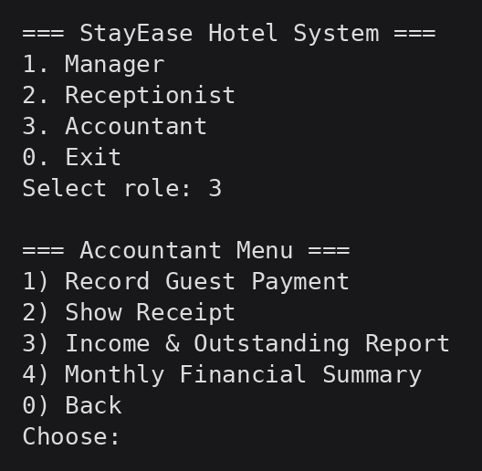
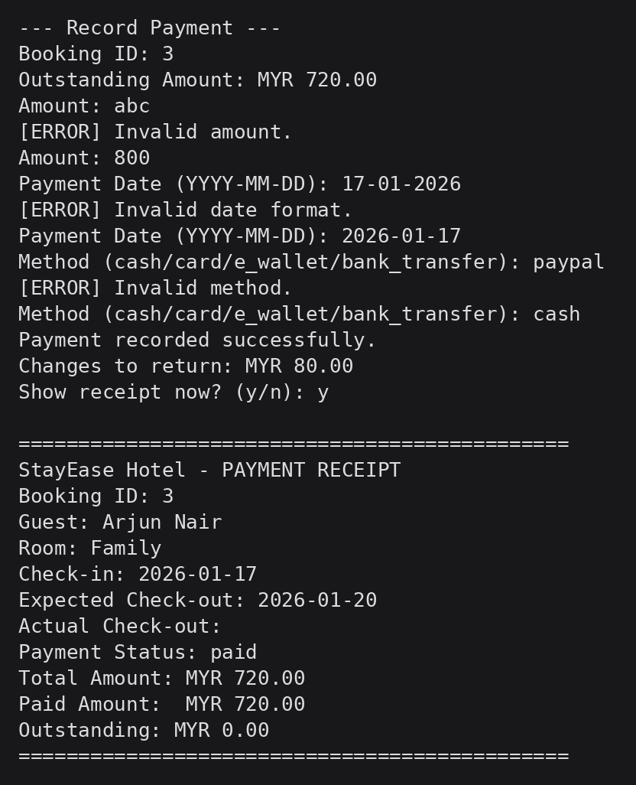
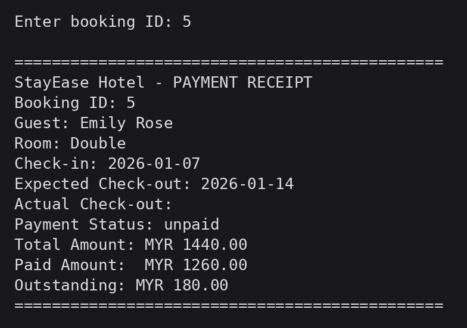
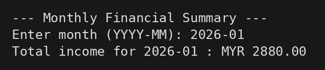
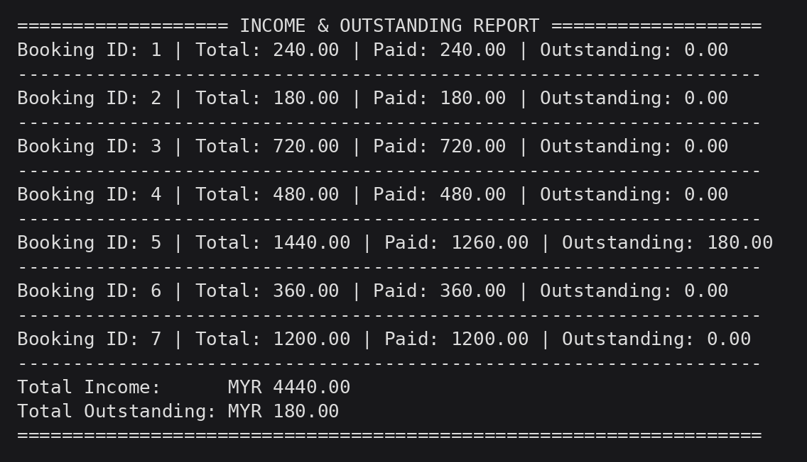

# StayEase: Hotel Reservation Management System (Python)

A command-line hotel management system in Python with three staff roles (Manager, Receptionist, Accountant) that share data through CSV files.

> Group project for **CT108-3-1-PYP Python Programming** at Asia Pacific University (APU), Malaysia, built by a team of 3 and submitted in January 2026.



## Contributions

Each team member owned one role module, and the report and `main.py` were shared equally.

### [Juan Tanoto](https://github.com/Juan-Tanoto): Accountant module

[`src/accountant.py`](src/accountant.py), about 360 of the ~1,000 lines of code.

- **Record guest payments** against a booking. The module shows the outstanding balance, supports partial payments, caps overpayment at the outstanding amount, and calculates the change to return.
- **Automatic payment status.** After every payment, the booking's status is recalculated from the sum of all its payments and written back to `bookings.csv`.
- **Text-based receipt** that joins data from three files (bookings, guests, rooms) and shows total, paid, and outstanding amounts.
- **Income & outstanding report** across all bookings, and a **monthly income summary** filtered by `YYYY-MM`.
- **Reusable CSV helpers** written without external libraries: read rows into dictionaries, rewrite a file, append a row, and create a missing file with the correct header.
- **Input validation** for booking IDs, amounts (numeric and positive), date format, and payment method, with clear error messages.

### [Davin Augusta Law](https://github.com/Dappinn-16): Manager module

[`src/manager.py`](src/manager.py): add, update, and remove rooms, system summary, and daily and monthly performance reports.

### [Aska Aidan](https://github.com/Vioclast): Receptionist module

[`src/receptionist.py`](src/receptionist.py): guest registration, room availability, bookings with automatic room assignment by room type, check-in, check-out with a late-stay fee, and cancellations.

## Features by Role

| Role | Main functions | Author |
|---|---|---|
| Manager | Add, update, remove rooms; system summary; daily and monthly performance reports | [Davin Augusta Law](https://github.com/Dappinn-16) |
| Receptionist | Register guests, view available rooms, create bookings with automatic room assignment, check-in, check-out with late check-out fee, cancel bookings | [Aska Aidan](https://github.com/Vioclast) |
| Accountant | Record payments, receipts, income & outstanding report, monthly summary | [Juan Tanoto](https://github.com/Juan-Tanoto) |

## Concepts Used

Modular design (one module per role), file handling with CSV storage, lists, tuples, and dictionaries, control structures, exception handling, and input validation.

## Project Structure

```
.
├── src/
│   ├── main.py           # Role selection menu
│   ├── accountant.py     # Accountant module
│   ├── manager.py
│   └── receptionist.py
├── data/                 # Sample CSV data
└── docs/screenshots/
```

## How to Run

Requires Python 3.8 or newer. No external packages are needed.

```bash
cd data
python ../src/main.py
```

The program reads and writes the CSV files in the current directory, so run it from inside `data/`. All guests and records in `data/` are fictional.

## Screenshots

**Recording a payment** (with input validation, change calculation, and receipt)



| Receipt for a partially paid booking | Monthly income summary |
|---|---|
|  |  |

**Income & outstanding report**



## Limitations and Possible Improvements

- Roles have no login, so anyone can open any menu. Role-based authentication would be the first addition.
- CSV is parsed by splitting on commas, so commas inside values are replaced with spaces. Python's `csv` module, or SQLite, would be more robust.
- Dates are checked for format (`YYYY-MM-DD`) but not for validity, e.g. `2026-13-45` is accepted. `datetime.strptime` would fix this.
- Designed for a single user at a time, with no file locking.
